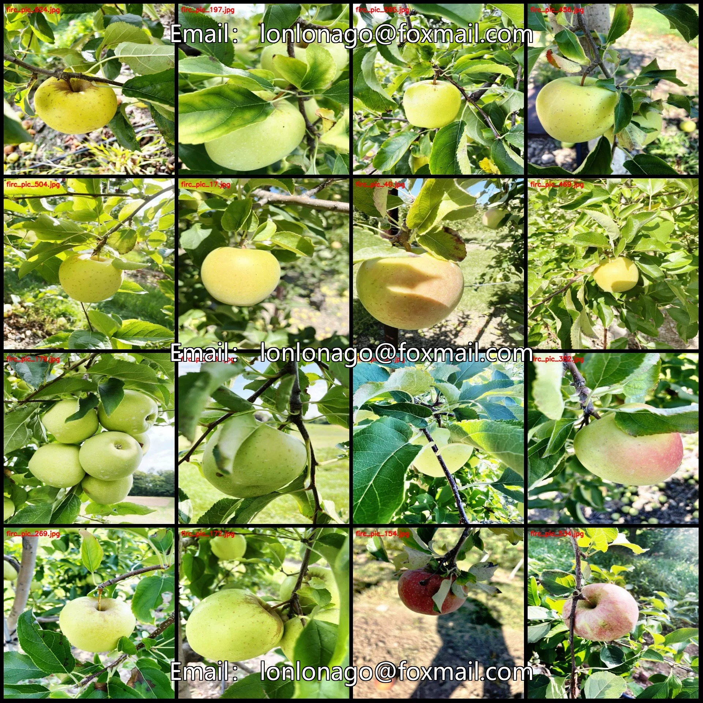
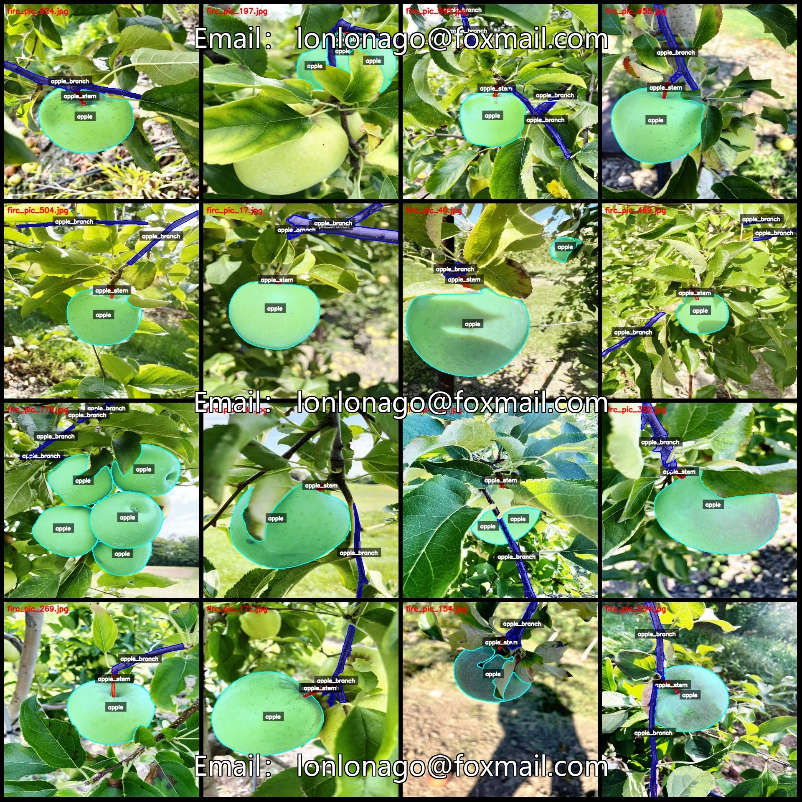
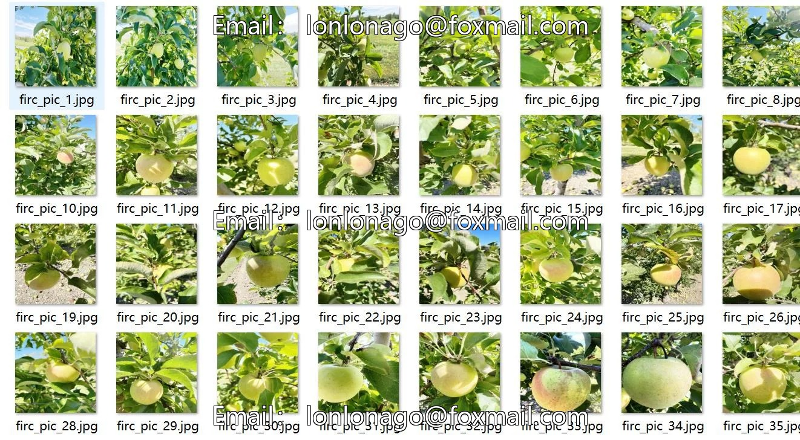
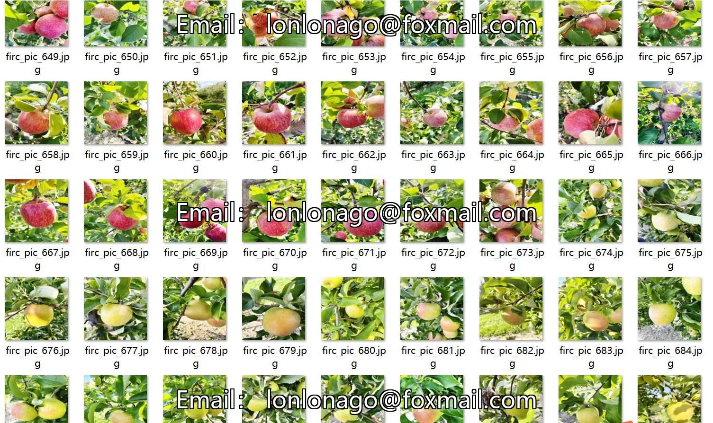
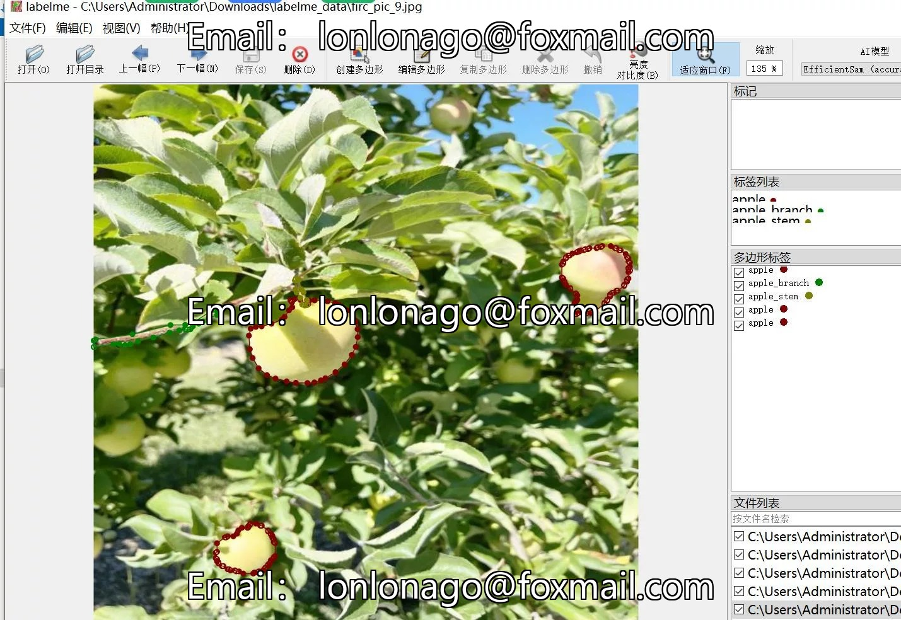
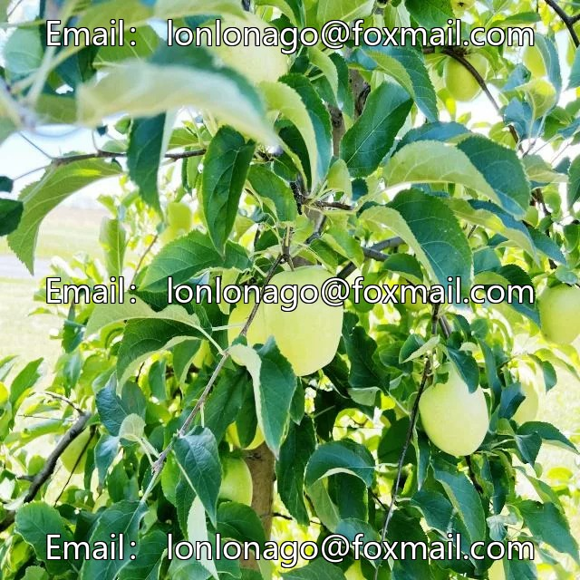
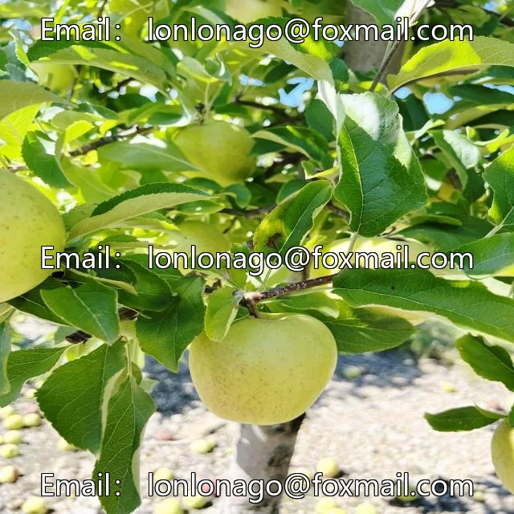
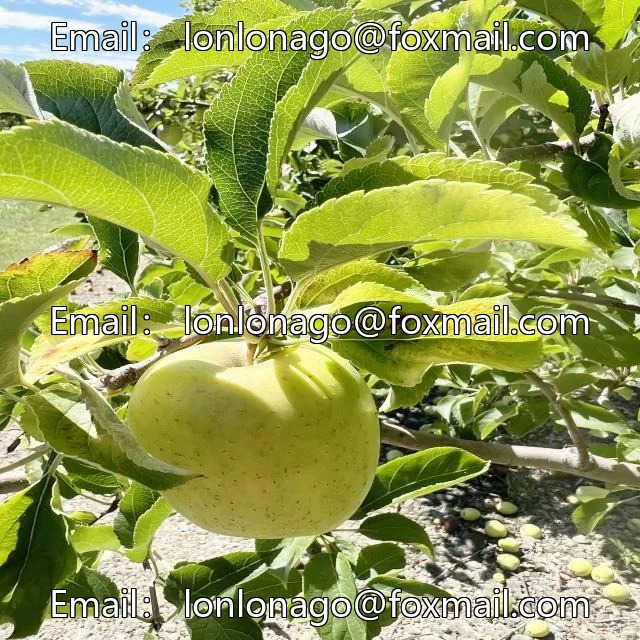

# Apple fruit stem branch identification and segmentation dataset - LabelMe format - 712 images in 3 categories

## Body

Apple fruit stem branch identification and segmentation dataset in LabelMe format: 712 images, 3 categories
Please note: Due to the dataset's replicability, after purchase, please confirm compliance before purchasing.
Dataset format: LabelMe format (excluding mask files, only including jpg images and corresponding json files)
Number of images (number of jpg files): 712
Number of annotations (number of json files): 712
Number of annotation categories: 3
Annotation category names: ["apple", "apple_branch", "apple_stem"]
Each category annotations count and image counts:
- apple (apple) box count = 1289, image count = 711

apple_branch (Apple Branch) frame count = 1606, occupied image count = 681
apple_stem (Apple Stem) frame count = 681, occupied image count = 650
Total frame count: 3576
Using labelme tool: labelme=5.5.0
Image resolution: 640x640
Annotation rules: Polygons are drawn around the category.
Important note: The dataset can be opened and edited using labelme. JSON datasets need to be converted into mask or yolo format or coco format for semantic segmentation or instance segmentation.
Special declaration: This dataset does not guarantee any accuracy in the trained models or weight files.

## Images

## Payment

Here is a pay link on Stripe ( https://buy.stripe.com/3cs8yP7sY87d0vu9AB ). Please contact me lonlonago@foxmail.com after funding $89, and I will send you a complete data files , thank you!

